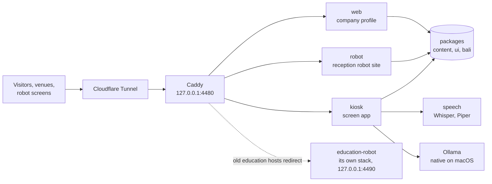

<div align="center">


# Taksu Tech

**Robots made in Bali by Taksu Tech, part of Ezra Robotics: the company profile, the reception
robots for Balinese offices and resorts (their site, the screen app they run, and its speech
service), and the education robots, with the Docker stack that runs them all on a Mac mini.**

[](https://github.com/DarmawanWeb/TaksuTech/actions/workflows/ci.yml)
[](https://github.com/DarmawanWeb/company-profile/actions/workflows/ci.yml)
[](https://github.com/DarmawanWeb/reception-robot-web/actions/workflows/ci.yml)
[](https://github.com/DarmawanWeb/reception-robot-kiosk/actions/workflows/ci.yml)
[](https://github.com/DarmawanWeb/reception-robot-speech/actions/workflows/ci.yml)
[](https://github.com/DarmawanWeb/education-robot/actions/workflows/ci.yml)
[](https://github.com/DarmawanWeb/TaksuTech/releases)


[](LICENSE)

[Repositories](#repositories) · [Features](#features) · [System](#system) · [Run it](#run-it) ·
[Deploy](#deploy-on-the-mac-mini) · [Releases](#releases) · [Documentation](#documentation) ·
[Develop](#develop)

</div>

---

Taksu Tech sells two lines of robots, each with its own site because the markets differ:
reception robots made for Bali (Snow and Timo in a Bali Edition, and Taksu Kiosk, a totem built
in-house) and education robots sold across Indonesia. This repository is the **deployment root**:
the infrastructure and the shared packages at the top level, every app in its own repository,
pinned here as a submodule.

## Repositories

| Path | Repository | |
|---|---|---|
| `apps/web` | [company-profile](https://github.com/DarmawanWeb/company-profile) | the company profile: services, works, blog, demos, contact |
| `apps/robot` | [reception-robot-web](https://github.com/DarmawanWeb/reception-robot-web) | the reception robot site: line-up, robot pages, comparison, Aksara Bali, demos |
| `apps/kiosk` | [reception-robot-kiosk](https://github.com/DarmawanWeb/reception-robot-kiosk) | the screen app on Snow, Timo, and the Taksu Kiosk totem |
| `services/speech` | [reception-robot-speech](https://github.com/DarmawanWeb/reception-robot-speech) | Whisper and Piper for the kiosk, on CPU |
| `education-robot` | [education-robot](https://github.com/DarmawanWeb/education-robot) | the education robots: a workspace of its own with the store ([education-robot-web](https://github.com/DarmawanWeb/education-robot-web)) and the simulator ([education-robot-sim](https://github.com/DarmawanWeb/education-robot-sim)) |

## Features

**Company**
- The company profile in Indonesian and English: both product lines, custom robots, PCBs, IoT,
  and web apps, the works page, an MDX blog with RSS, demos, and a contact form that hands the
  message to WhatsApp or email.

**Reception robots**
- A site with the line-up drawn to the robots' real heights, a page and a demo per robot, a
  comparison, the Aksara Bali regulation with a live sign, and today's Pawukon day.
- One screen app for the 13.3-inch screens on Snow and Timo and the 24-inch portrait totem: queue
  tickets, a guest book, directions on the floor plan, the venue's organisation, Balinese customs,
  and Aksara Bali above the Latin on every sign.
- An assistant that answers from the venue's data, offline or through Ollama (native on the Mac
  mini), Anthropic, or any OpenAI-compatible API; Whisper and Piper for listening and speaking,
  with the robot's mouth following the voice; tickets and passes on 80 mm thermal paper.

**Education robots**
- Named robots, their store, learning paths, and the block simulator live in
  [education-robot](https://github.com/DarmawanWeb/education-robot), which runs as its own stack.
  The old education hosts here redirect to it.

**Operate**
- One Docker image per app, the speech service, and Caddy behind the existing Cloudflare Tunnel;
  Prometheus, Loki, Alloy, and Grafana with a ready dashboard; CI here and in every app's
  repository; images on GHCR.

## System



| Path | |
|---|---|
| `packages/content/` | every fact the sites show: brand and names, both product lines, robots, venues, works, demos |
| `packages/ui/` | shared components and three themes: `company.css`, `theme.css` (the reception line, Bali), `edu.css` |
| `packages/bali/` | Aksara Bali transliteration, Balinese numerals, greetings, the Pawukon calendar |
| `packages/typescript-config/` | shared TypeScript settings |
| `docker/Dockerfile` | one standalone Next.js image per app |
| `docker-compose.yml`, `infra/caddy/` | the stack: web, robot, kiosk, speech, and Caddy on the loopback |
| `infra/monitoring/`, `infra/ollama/` | Prometheus, Loki, Alloy, Grafana; the `taksu-asisten` model |
| `infra/deploy.sh`, `infra/scripts/` | deploy with a smoke test, and the cloudflared hostnames |

## Run it

```bash
git clone --recursive https://github.com/DarmawanWeb/TaksuTech.git && cd TaksuTech
pnpm install        # also installs the commit hooks, here and in each app and the speech service
pnpm dev            # web :3000, kiosk :3001, robot :3004
pnpm check          # Biome, typecheck, tests
pnpm test:speech    # the speech service's tests (Python, ffmpeg)
```

Without the speech service the kiosk listens and speaks through the browser; to try Whisper and
Piper, run it on port 8000 and set `SPEECH_URL=http://localhost:8000` in `apps/kiosk/.env.local`
([how](https://github.com/DarmawanWeb/reception-robot-speech#develop)). The education robots have
their own workspace: `cd education-robot && pnpm install`.

## Deploy on the Mac mini

Everything runs in Docker; only Caddy opens a port, `127.0.0.1:4480`. Ollama stays native on
macOS to use the Metal GPU, and the containers reach it at `host.docker.internal:11434`.

```bash
git clone --recursive https://github.com/DarmawanWeb/TaksuTech.git ~/web/taksu-tech
cd ~/web/taksu-tech
cp infra/.env.example ~/web/taksu-tech.env     # hosts, CLOUDFLARE_TUNNEL, GRAFANA_ADMIN_PASSWORD
infra/ollama/setup.sh                           # once: the taksu-asisten model
ENV_FILE=~/web/taksu-tech.env infra/deploy.sh   # pinned apps, build, start, smoke test
ENV_FILE=~/web/taksu-tech.env CLOUDFLARED_CONFIG=~/.cloudflared/config.yml infra/scripts/cloudflare-ingress.sh
```

The education robots run next to it as a second Compose project from the same clone:
`ENV_FILE=~/web/education-robot.env education-robot/infra/deploy.sh` (see
[education-robot](https://github.com/DarmawanWeb/education-robot#deploy-on-the-mac-mini)).
`.github/workflows/deploy-macmini.yml` deploys every green `main` from a self-hosted runner.

<details>
<summary><b>Hostnames and configuration</b></summary>

| Hostname (default) | Goes to |
|---|---|
| `taksu.agus-darmawan.com` | web, the company profile |
| `taksu-robot.agus-darmawan.com` | robot, the reception robot site |
| `taksu-kiosk.agus-darmawan.com` | kiosk, with the microphone allowed |
| `taksu-edu.agus-darmawan.com` | a redirect to the education-robot store |
| `taksu-sim.agus-darmawan.com` | a redirect to the education-robot simulator |
| `taksu-grafana.agus-darmawan.com` | Grafana; protect it with Cloudflare Access |

Every hostname points cloudflared at the one target `http://127.0.0.1:4480`, and Caddy routes by
host. The ingress script backs up `config.yml`, inserts the rules before `http_status:404`,
validates, creates the CNAMEs, and restarts cloudflared.

| Variable (`infra/.env`) | What it does |
|---|---|
| `WEB_HOST`, `ROBOT_HOST`, `KIOSK_HOST`, `GRAFANA_HOST` | the hostnames above |
| `EDU_HOST`, `SIM_HOST` | the old education hosts, which now redirect |
| `EDUCATION_HOST`, `EDUCATION_SIM_HOST` | where they redirect: education-robot's store and simulator |
| `CADDY_PORT` | Caddy on the loopback, 4480; never 80 or 8080 on this Mac mini |
| `MONITORING` | `1` also runs Prometheus, Loki, Alloy, blackbox, and Grafana |
| `CLOUDFLARE_TUNNEL` | the existing tunnel, for the ingress script |
| `WHATSAPP_NUMBER` | where enquiries go; empty means email only |
| `AI_*`, `ASSISTANT_RATE_LIMIT` | the kiosk's assistant: provider, model, timeouts, concurrency, rate limit |
| `WHISPER_*`, `PIPER_VOICE_*` | the speech service's model and voices |
| `GRAFANA_ADMIN_USER`, `GRAFANA_ADMIN_PASSWORD` | Grafana's own login |

Public values are inlined into the images at build time, so change them and deploy again. On the
first start the speech service downloads Whisper `small` and the Piper voices into the
`speech_models` volume; until then the kiosk uses the browser's voice. With `MONITORING=1`,
Prometheus scrapes Caddy and probes web, robot, kiosk, speech, and Ollama; Alloy ships every
container's log in the `taksu` project to Loki; Grafana opens on the **Taksu Tech: layanan**
dashboard.

</details>

## Releases

| Version | |
|---|---|
| [v2.0.0](https://github.com/DarmawanWeb/TaksuTech/releases/tag/v2.0.0) | Taksu Tech in repositories: the company profile, the reception robot site, the kiosk, and the speech service each in their own, pinned here; the education line rebuilt as named robots in education-robot v2.0.0, with the old education hosts redirecting there. |
| [v1.0.0](https://github.com/DarmawanWeb/TaksuTech/releases/tag/v1.0.0) | The MVP as one monorepo: the company profile and blog, Taksu Edu with kits per school level and a curriculum, the reception robot site and the kiosk with a voice assistant, the simulator, Aksara Bali, Docker and monitoring. |

The first 274 commits are that monorepo, unchanged; every app's repository carries its own part of
that history. `refactor: split the company profile, robot site, kiosk, and speech service into
repositories` starts v2.

## Documentation

| For | Document |
|---|---|
| Contributors | [CONTRIBUTING.md](CONTRIBUTING.md): working with the submodules, house rules, blog posts, works |
| Company profile | [company-profile/docs](https://github.com/DarmawanWeb/company-profile/tree/main/docs): architecture, development |
| Reception robot site | [reception-robot-web/docs](https://github.com/DarmawanWeb/reception-robot-web/tree/main/docs): architecture, development |
| Kiosk | [reception-robot-kiosk/docs](https://github.com/DarmawanWeb/reception-robot-kiosk/tree/main/docs): screens, assistant, voice, printing, venues |
| Speech service | [reception-robot-speech/docs](https://github.com/DarmawanWeb/reception-robot-speech/tree/main/docs): engines, API, voices |
| Education robots | [education-robot](https://github.com/DarmawanWeb/education-robot): its README and contributing guide |

## Develop

```bash
git submodule update --init --recursive
pnpm install        # husky here, and the same hooks inside each app and the speech service
```

Change an app inside its submodule and push it there, then commit the new pointer here
(`chore: update kiosk`); Dependabot opens that pull request weekly too. The `ci` workflow checks
out the submodules and runs Biome, the typecheck, the tests, the builds, and the speech tests, and
validates the compose file, the Caddyfile, and the shell scripts; each app's repository has its
own CI. `docker.yml` publishes `ghcr.io/darmawanweb/company-profile`, `reception-robot-web`, and
`reception-robot-kiosk` on `main` and `v*` tags.

<details>
<summary><b>Brand</b></summary>

- **Names:** `packages/content/src/names.ts`. The reception line's own name is still to be
  decided, so every site reads it from there; public copy carries the Taksu Tech label only, with
  no OEM names.
- **Company profile:** `company.css`, plain on purpose: white and petrol `#12343b`, cyan
  `#1fb0cf` for small accents, Hubot Sans and Mona Sans. The mark is a T drawn as a PCB trace that
  turns at 45° and ends in a via.
- **Reception line:** `theme.css`, made for Bali: Paras stone, Endek indigo, Malam night, Prada
  gold, Subak water; Aksara Bali above the Latin, as Pergub Bali 80/2018 asks. It is generated, so
  official signage is reviewed by a Balinese language adviser.
- **Claims:** no TKDN percentage for Taksu Kiosk before certification. `piper-tts` is GPL-3.0 and
  runs as its own service; check each voice's licence before commercial use.

</details>

Proprietary. Copyright (c) 2026 Taksu Tech, part of Ezra Robotics. All rights reserved.
