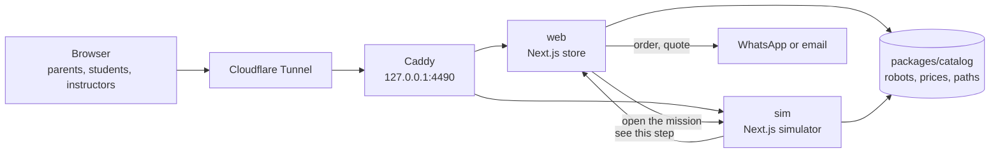

<div align="center">


# Taksu Education Robots

**Named, numbered robots for children, teenagers, and competition teams, each sold with a free
online learning path: the store where they are chosen and understood, the simulator where their
programs are tested first, and the stack that runs both. By Taksu Tech.**

[](https://github.com/DarmawanWeb/education-robot/actions/workflows/ci.yml)
[](https://github.com/DarmawanWeb/education-robot-web/actions/workflows/ci.yml)
[](https://github.com/DarmawanWeb/education-robot-sim/actions/workflows/ci.yml)
[](https://github.com/DarmawanWeb/education-robot/releases)


[](LICENSE)

[Robots](#robots) · [Features](#features) · [System](#system) · [Run it](#run-it) ·
[Deploy](#deploy-on-the-mac-mini) · [Releases](#releases) · [Documentation](#documentation) ·
[Develop](#develop)

</div>

---

Every robot has a name, a number, and its own learning path, and the R&D releases called Drops
continue the same number series. This repository is the **deployment root**: the infrastructure
and the shared packages at the top level, the store and the simulator in two submodules. It sits
inside [TaksuTech](https://github.com/DarmawanWeb/TaksuTech) as `education-robot`, next to the
company profile and the reception robots.

## Robots

| # | Robot | Starts at | For | Status |
|---|---|---|---|---|
| 01 | Ciko | age 7 | a first robot car, ready to program | pre-order |
| 02 | Momo | age 11 | a modular ESP32 robot that rebuilds four ways | pre-order |
| 03 | Garu | age 15 | a ROS 2 rover with a camera, LiDAR, and an arm | coming soon |
| 04 | ?? | | the next **Drop** from the R&D bench | revealed at launch |

## Features

**Shop**
- Robots by age and goal; a page per robot with packages, add-ons, and the first steps of its
  learning path; accessories, upgrade packs, and arenas.
- A cart that turns the order and the delivery address into one WhatsApp message or email, with
  no payment on the site. Tokopedia and Shopee buttons appear once their links are set.

**Drops**
- Small robots from the R&D bench, revealed one at a time with the next number in the series.

**Learn**
- A free learning path per robot: steps that pair one idea with a simulator mission or a guide,
  and curated videos that load only after a click. Not a class: followed at home, at any pace.

**Business**
- Bulk orders for schools, courses, and competition teams, with training for instructors; OEM at
  three depths, from a rebrand to a new robot; a quote form.

**Simulate**
- Blocks for Ciko and Momo with real sensors and physics, 18 missions that are the steps of the
  learning paths, and the Arduino C++ each program becomes.

**Operate**
- Indonesian and English, social cards, a sitemap; one Docker image per app and Caddy behind the
  Cloudflare Tunnel on a Mac mini; CI on every push.

## System



| Path | |
|---|---|
| [`apps/web/`](https://github.com/DarmawanWeb/education-robot-web) | the store: robots, Drops, accessories, cart, learning paths, guides, business, help |
| [`apps/sim/`](https://github.com/DarmawanWeb/education-robot-sim) | the block simulator for Ciko and Momo, with Arduino C++ output |
| `packages/catalog/` | every product fact: brand, robots, prices, accessories, Drops, learning paths, guides, questions, business offers |
| `packages/ui/` | the Taksu theme (`taksu.css`), wordmark, race-number plate, shared components |
| `packages/typescript-config/` | shared TypeScript settings |
| `docker/Dockerfile` | one standalone Next.js image per app |
| `docker-compose.yml`, `infra/caddy/` | the stack: web, sim, and Caddy on the loopback |
| `infra/deploy.sh`, `infra/scripts/` | deploy with a smoke test, and the cloudflared hostnames |

## Run it

```bash
git clone --recursive https://github.com/DarmawanWeb/education-robot.git && cd education-robot
pnpm install        # also installs the commit hooks, here and in each submodule
pnpm dev:web        # http://localhost:3100/id
pnpm dev:sim        # http://localhost:3102/id
pnpm check          # Biome, typecheck, tests
```

Copy `apps/web/.env.example` to `apps/web/.env.local` to try ordering with a WhatsApp number.

## Deploy on the Mac mini

The stack runs next to Taksu Tech's own stack as a separate Compose project (`education-robot`):
`web`, `sim`, and a Caddy on `127.0.0.1:4490` for the existing cloudflared tunnel.

```bash
git clone --recursive https://github.com/DarmawanWeb/education-robot.git ~/web/education-robot
cd ~/web/education-robot
cp infra/.env.example ~/web/education-robot.env        # WHATSAPP_NUMBER and the hosts
ENV_FILE=~/web/education-robot.env infra/deploy.sh     # pinned submodules, build, smoke test
ENV_FILE=~/web/education-robot.env infra/scripts/cloudflare-ingress.sh   # once: both hostnames
```

<details>
<summary><b>Configuration</b></summary>

Everything public is inlined at build time, so change it and redeploy.

| Variable (web) | Set from `infra/.env` | What it does |
|---|---|---|
| `NEXT_PUBLIC_WEB_URL` | `WEB_HOST` | canonical links, sitemap, social cards |
| `NEXT_PUBLIC_SIM_URL` | `SIM_HOST` | every "open in the simulator" link |
| `NEXT_PUBLIC_WHATSAPP_NUMBER` | `WHATSAPP_NUMBER` | where orders and quotes go; empty means email only |
| `NEXT_PUBLIC_EMAIL` | `CONTACT_EMAIL` | email orders; defaults to `brand.contact.email` |
| `NEXT_PUBLIC_TOKOPEDIA_URL` | `TOKOPEDIA_URL` | the Tokopedia store; the button hides while empty |
| `NEXT_PUBLIC_SHOPEE_URL` | `SHOPEE_URL` | the Shopee store; the button hides while empty |

The simulator only needs `NEXT_PUBLIC_WEB_URL`, for its links back to the store. `CADDY_PORT`
(4490) and `CLOUDFLARE_TUNNEL` are for the scripts.

</details>

## Releases

| Version | |
|---|---|
| [v2.0.0](https://github.com/DarmawanWeb/education-robot/releases/tag/v2.0.0) | Taksu Education Robots: named robots, the store, Drops, accessories, learning paths, business, and the simulator for Ciko and Momo, with the store and the simulator in their own repositories. Built under the working name ULIK. |
| [v1.0.0](https://github.com/DarmawanWeb/education-robot/releases/tag/v1.0.0) | Taksu Tech MVP: the company profile and blog, Taksu Edu with kits per school level and a curriculum, the reception-robot site and the kiosk with a voice assistant, the simulator, Balinese script, Docker and monitoring. |

The first 274 commits are Taksu Tech v1; `chore: close Taksu Tech v1 for the education robots`
starts the rebuild.

## Documentation

| For | Document |
|---|---|
| Contributors | [CONTRIBUTING.md](CONTRIBUTING.md): working with the submodules, house rules, selling something new |
| Store developers | [education-robot-web/docs](https://github.com/DarmawanWeb/education-robot-web/tree/main/docs): architecture, development |
| Simulator developers | [education-robot-sim/docs](https://github.com/DarmawanWeb/education-robot-sim/tree/main/docs): architecture, development |
| Product facts | [`packages/catalog/src`](packages/catalog/src): robots, prices, paths, guides, questions |

## Develop

```bash
git submodule update --init --recursive
pnpm install        # husky here, and the same hooks inside apps/web and apps/sim
```

Change an app inside its submodule and push it there, then commit the new pointer here
(`chore: update web and sim`); Dependabot opens that pull request weekly too. The `ci` workflow
checks out the submodules and runs Biome, the typecheck, the tests, and both builds, and validates
the compose file, the Caddyfile, and the shell scripts; each submodule has its own CI.
`docker.yml` publishes `ghcr.io/darmawanweb/education-robot-web` and `-sim` on `main` and `v*`
tags.

<details>
<summary><b>Brand</b></summary>

- **Name:** `packages/catalog/src/brand.ts`, then `python3 packages/ui/scripts/wordmark.py <name>`
  redraws the logo (`pip install fonttools brotli`). The amber dot is a turn signal.
- **Colours:** Ciko's livery. Red `#e3262d` for actions, asphalt `#1f2228` for dark bands, chalk
  `#f4f5f7` for the page, eye cyan `#44ddeb` for learning, signal amber `#ffb020` for Drops and
  "coming soon"; each robot owns a colour.
- **Type:** Anybody (wide, heavy) for headlines and race numbers; Atkinson Hyperlegible Next for
  everything else.

Prices, ages, and the policies in the questions are starting points: review them in
`packages/catalog` before launch.

</details>

Proprietary. Copyright (c) 2026 Taksu Tech, part of Ezra Robotics. All rights reserved.
