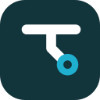
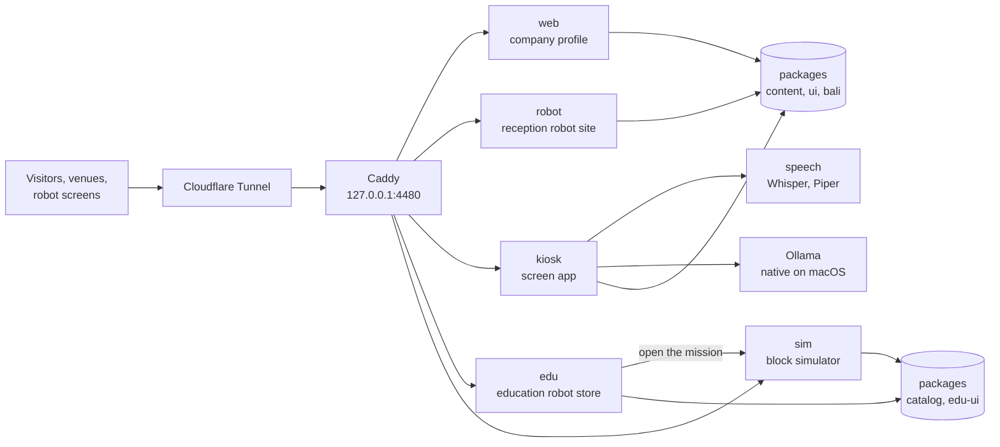

<div align="center">



# Taksu Tech

**Robots made in Bali by Taksu Tech, part of Ezra Robotics: the company profile, the reception
robots for Balinese offices and resorts (their site, the screen app they run, and its speech
service), and the education robots (their store and block simulator), with the Docker stack that
runs them all on a Mac mini.**

[](https://github.com/DarmawanWeb/TaksuTech/actions/workflows/ci.yml)
[](https://github.com/DarmawanWeb/company-profile/actions/workflows/ci.yml)
[](https://github.com/DarmawanWeb/reception-robot-web/actions/workflows/ci.yml)
[](https://github.com/DarmawanWeb/reception-robot-kiosk/actions/workflows/ci.yml)
[](https://github.com/DarmawanWeb/reception-robot-speech/actions/workflows/ci.yml)
[](https://github.com/DarmawanWeb/education-robot-web/actions/workflows/ci.yml)
[](https://github.com/DarmawanWeb/education-robot-sim/actions/workflows/ci.yml)
[](https://github.com/DarmawanWeb/TaksuTech/releases)


[](LICENSE)

[Repositories](#repositories) · [Features](#features) · [System](#system) · [Run it](#run-it) ·
[Locally](#run-the-stack-locally) · [Deploy](#deploy-on-the-mac-mini) · [Releases](#releases) ·
[Documentation](#documentation) · [Develop](#develop)

</div>

---

Taksu Tech sells two lines of robots, each with its own site because the markets differ:
reception robots made for Bali (Snow and Timo in a Bali Edition, and Taksu Kiosk, a totem built
in-house) and education robots sold across Indonesia. This repository is the **deployment root**:
the infrastructure and the shared packages at the top level, every app in its own repository,
pinned here as a submodule.

## Repositories

| Path | Repository | |
|---|---|---|
| `apps/web` | [company-profile](https://github.com/DarmawanWeb/company-profile) | the company profile: services, works, blog, demos, contact |
| `apps/robot` | [reception-robot-web](https://github.com/DarmawanWeb/reception-robot-web) | the reception robot site: line-up, robot pages, comparison, Aksara Bali, demos |
| `apps/kiosk` | [reception-robot-kiosk](https://github.com/DarmawanWeb/reception-robot-kiosk) | the screen app on Snow, Timo, and the Taksu Kiosk totem |
| `apps/edu` | [education-robot-web](https://github.com/DarmawanWeb/education-robot-web) | the education robots' store: robots, Drops, accessories, learning paths, business |
| `apps/sim` | [education-robot-sim](https://github.com/DarmawanWeb/education-robot-sim) | the block simulator for Ciko and Momo, with Arduino C++ output |
| `services/speech` | [reception-robot-speech](https://github.com/DarmawanWeb/reception-robot-speech) | Whisper and Piper for the kiosk, on CPU |

## Features

**Company**
- The company profile in Indonesian and English: both product lines, custom robots, PCBs, IoT,
  and web apps, the works page, an MDX blog with RSS, demos, and a contact form that hands the
  message to WhatsApp or email.

**Reception robots**
- A site with the line-up drawn to the robots' real heights, a page and a demo per robot, a
  comparison, the Aksara Bali regulation with a live sign, and today's Pawukon day.
- One screen app for the 13.3-inch screens on Snow and Timo and the 24-inch portrait totem: queue
  tickets, a guest book, directions on the floor plan, the venue's organisation, Balinese customs,
  and Aksara Bali above the Latin on every sign.
- An assistant that answers from the venue's data, offline or through Ollama (native on the Mac
  mini), Anthropic, or any OpenAI-compatible API; Whisper and Piper for listening and speaking,
  with the robot's mouth following the voice; tickets and passes on 80 mm thermal paper.

**Education robots**

| # | Robot | Starts at | For | Status |
|---|---|---|---|---|
| 01 | Ciko | age 7 | a first robot car, ready to program | pre-order |
| 02 | Momo | age 11 | a modular ESP32 robot that rebuilds four ways | pre-order |
| 03 | Garu | age 15 | a ROS 2 rover with a camera, LiDAR, and an arm | coming soon |
| 04 | ?? | | the next **Drop** from the R&D bench | revealed at launch |

- A store with a page per robot, packages and add-ons, accessories, upgrade packs, arenas, and
  the Drops; a cart that turns the order into one WhatsApp message or email, with no payment on
  the site; bulk orders, training, and OEM for schools and teams.
- A free learning path per robot, each step one idea with a simulator mission or a guide, and a
  block simulator for Ciko and Momo with real sensors, 18 missions, and the Arduino C++ each
  program becomes.

**Operate**
- One Docker image per app, the speech service, and Caddy behind the existing Cloudflare Tunnel;
  Prometheus, Loki, Alloy, and Grafana with a ready dashboard; CI here and in every app's
  repository; images on GHCR.

## System



| Path | |
|---|---|
| `packages/content/` | every fact the sites show: brand and names, both product lines, robots, venues, works, demos |
| `packages/ui/` | shared components and two themes: `company.css` (the company profile) and `theme.css` (the reception line and the kiosk, Bali) |
| `packages/bali/` | Aksara Bali transliteration, Balinese numerals, greetings, the Pawukon calendar |
| `packages/catalog/` | every fact the education robots' store and simulator show: robots, prices, accessories, Drops, learning paths, guides, missions |
| `packages/edu-ui/` | the education robots' theme (`taksu.css`), wordmark, race-number plate, components |
| `packages/typescript-config/` | shared TypeScript settings |
| `docker/Dockerfile` | one standalone Next.js image per app |
| `docker-compose.yml`, `infra/caddy/` | the stack: web, robot, kiosk, edu, sim, speech, and Caddy on the loopback |
| `infra/monitoring/`, `infra/ollama/` | Prometheus, Loki, Alloy, Grafana; the `taksu-asisten` model |
| `infra/deploy.sh`, `infra/scripts/` | deploy with a smoke test, and the cloudflared hostnames |

## Run it

```bash
git clone --recursive https://github.com/DarmawanWeb/TaksuTech.git && cd TaksuTech
pnpm install        # also installs the commit hooks, here and in each app and the speech service
pnpm dev            # web :3000, kiosk :3001, sim :3002, edu :3003, robot :3004
pnpm check          # Biome, typecheck, tests
pnpm test:speech    # the speech service's tests (Python, ffmpeg)
```

Without the speech service the kiosk listens and speaks through the browser; to try Whisper and
Piper, run it on port 8000 and set `SPEECH_URL=http://localhost:8000` in `apps/kiosk/.env.local`
([how](https://github.com/DarmawanWeb/reception-robot-speech#develop)). Set
`NEXT_PUBLIC_WHATSAPP_NUMBER` in `apps/edu/.env.local` to try the store's WhatsApp orders.

## Run the stack locally

The same Docker stack runs on a laptop without the tunnel, next to other local stacks:

```bash
cp infra/.env.local.example infra/.env
infra/deploy.sh     # then open http://taksu.localhost:4480
```

The sites answer on `taksu.localhost`, `robot.`, `kiosk.`, `edu.`, and `sim.taksu.localhost`, all
through Caddy on `127.0.0.1:4480`. Nothing else is published and nothing listens on the LAN; the
speech service, Grafana, and the apps stay inside the `taksu` Docker network. Ports this stack
uses, so it does not collide with the others:

| Port | Used by |
|---|---|
| `127.0.0.1:4480` | Caddy, the only published port (`CADDY_PORT`) |
| `3100` to `3104` | `pnpm dev` only: web, kiosk, sim, edu, robot |
| `11434` | Ollama, native on macOS, shared; set `AI_BASE_URL` if another stack runs its own |

Stop it with `docker compose -p taksu down` (add `-v` to drop the speech models and data).

## Deploy on the Mac mini

Everything runs in Docker; only Caddy opens a port, `127.0.0.1:4480`. Ollama stays native on
macOS to use the Metal GPU, and the containers reach it at `host.docker.internal:11434`.

```bash
git clone --recursive https://github.com/DarmawanWeb/TaksuTech.git ~/web/taksu-tech
cd ~/web/taksu-tech
cp infra/.env.example ~/web/taksu-tech.env     # hosts, CLOUDFLARE_TUNNEL, GRAFANA_ADMIN_PASSWORD
infra/ollama/setup.sh                           # once: the taksu-asisten model
ENV_FILE=~/web/taksu-tech.env infra/deploy.sh   # pinned apps, build, start, smoke test
ENV_FILE=~/web/taksu-tech.env CLOUDFLARED_CONFIG=~/.cloudflared/config.yml infra/scripts/cloudflare-ingress.sh
```

`.github/workflows/deploy-macmini.yml` deploys every green `main` from a self-hosted runner.

<details>
<summary><b>Hostnames and configuration</b></summary>

| Hostname (default) | Goes to |
|---|---|
| `taksu.agus-darmawan.com` | web, the company profile |
| `taksu-robot.agus-darmawan.com` | robot, the reception robot site |
| `taksu-kiosk.agus-darmawan.com` | kiosk, with the microphone allowed |
| `taksu-edu.agus-darmawan.com` | edu, the education robots' store |
| `taksu-sim.agus-darmawan.com` | sim, the block simulator |
| `taksu-grafana.agus-darmawan.com` | Grafana; protect it with Cloudflare Access |

Every hostname points cloudflared at the one target `http://127.0.0.1:4480`, and Caddy routes by
host. The ingress script backs up `config.yml`, inserts the rules before `http_status:404`,
validates, creates the CNAMEs, and restarts cloudflared.

| Variable (`infra/.env`) | What it does |
|---|---|
| `WEB_HOST`, `ROBOT_HOST`, `KIOSK_HOST`, `EDU_HOST`, `SIM_HOST`, `GRAFANA_HOST` | the hostnames above |
| `CADDY_PORT` | Caddy on the loopback, 4480; never 80 or 8080 on this Mac mini |
| `MONITORING` | `1` also runs Prometheus, Loki, Alloy, blackbox, and Grafana |
| `CLOUDFLARE_TUNNEL` | the existing tunnel, for the ingress script |
| `WHATSAPP_NUMBER` | where enquiries and store orders go; empty means email only |
| `CONTACT_EMAIL` | the store's email orders; defaults to `brand.contact.email` in `packages/catalog` |
| `TOKOPEDIA_URL`, `SHOPEE_URL` | the store's marketplace pages; each button hides while empty |
| `AI_*`, `ASSISTANT_RATE_LIMIT` | the kiosk's assistant: provider, model, timeouts, concurrency, rate limit |
| `WHISPER_*`, `PIPER_VOICE_*` | the speech service's model and voices |
| `GRAFANA_ADMIN_USER`, `GRAFANA_ADMIN_PASSWORD` | Grafana's own login |

Public values are inlined into the images at build time, so change them and deploy again. On the
first start the speech service downloads Whisper `small` and the Piper voices into the
`speech_models` volume; until then the kiosk uses the browser's voice. With `MONITORING=1`,
Prometheus scrapes Caddy and probes web, robot, kiosk, edu, sim, speech, and Ollama; Alloy ships
every container's log in the `taksu` project to Loki; Grafana opens on the **Taksu Tech: layanan**
dashboard.

</details>

## Releases

| Version | |
|---|---|
| [v2.0.0](https://github.com/DarmawanWeb/TaksuTech/releases/tag/v2.0.0) | Taksu Tech in repositories, every app pinned here side by side; the education line rebuilt as named robots (Ciko, Momo, Garu) with a store, Drops, learning paths, and a simulator, built under the working name ULIK; the company profile tells the new line. |
| [v1.0.0](https://github.com/DarmawanWeb/TaksuTech/releases/tag/v1.0.0) | The MVP as one monorepo: the company profile and blog, Taksu Edu with kits per school level and a curriculum, the reception robot site and the kiosk with a voice assistant, the simulator, Aksara Bali, Docker and monitoring. |

The first 274 commits are that monorepo, unchanged; every app's repository carries its own part of
that history. `refactor: split the company profile, robot site, kiosk, and speech service into
repositories` starts v2, and the education robots' rebuild joins it through the merge
`refactor: bring the store and the simulator into apps, next to the other apps`.

## Documentation

| For | Document |
|---|---|
| Contributors | [CONTRIBUTING.md](CONTRIBUTING.md): working with the submodules, house rules, blog posts, works |
| Company profile | [company-profile/docs](https://github.com/DarmawanWeb/company-profile/tree/main/docs): architecture, development |
| Reception robot site | [reception-robot-web/docs](https://github.com/DarmawanWeb/reception-robot-web/tree/main/docs): architecture, development |
| Kiosk | [reception-robot-kiosk/docs](https://github.com/DarmawanWeb/reception-robot-kiosk/tree/main/docs): screens, assistant, voice, printing, venues |
| Speech service | [reception-robot-speech/docs](https://github.com/DarmawanWeb/reception-robot-speech/tree/main/docs): engines, API, voices |
| Education store | [education-robot-web/docs](https://github.com/DarmawanWeb/education-robot-web/tree/main/docs): architecture, development |
| Simulator | [education-robot-sim/docs](https://github.com/DarmawanWeb/education-robot-sim/tree/main/docs): architecture, development |

## Develop

```bash
git submodule update --init --recursive
pnpm install        # husky here, and the same hooks inside each app and the speech service
```

Change an app inside its submodule and push it there, then commit the new pointer here
(`chore: update kiosk`); Dependabot opens that pull request weekly too. The `ci` workflow checks
out the submodules and runs Biome, the typecheck, the tests, the builds, and the speech tests, and
validates the compose file, the Caddyfile, and the shell scripts; each app's repository has its
own CI. `docker.yml` publishes `ghcr.io/darmawanweb/company-profile`, `reception-robot-web`,
`reception-robot-kiosk`, `education-robot-web`, and `education-robot-sim` on `main` and `v*` tags.

<details>
<summary><b>Brand</b></summary>

- **Names:** `packages/content/src/names.ts`. The reception line's own name is still to be
  decided, so every site reads it from there; public copy carries the Taksu Tech label only, with
  no OEM names.
- **Company profile:** `company.css`, plain on purpose: white and petrol `#12343b`, cyan
  `#1fb0cf` for small accents, Hubot Sans and Mona Sans. The mark is a T drawn as a PCB trace that
  turns at 45° and ends in a via.
- **Reception line:** `theme.css`, made for Bali: Paras stone, Endek indigo, Malam night, Prada
  gold, Subak water; Aksara Bali above the Latin, as Pergub Bali 80/2018 asks. It is generated, so
  official signage is reviewed by a Balinese language adviser.
- **Education robots:** `taksu.css` in `packages/edu-ui`, Ciko's livery: red `#e3262d` for actions,
  asphalt `#1f2228`, chalk `#f4f5f7`, eye cyan `#44ddeb` for learning, signal amber `#ffb020` for
  Drops; Anybody for headlines and race numbers, Atkinson Hyperlegible Next for text.
  `python3 packages/edu-ui/scripts/wordmark.py <name>` redraws the wordmark.
- **Claims:** no TKDN percentage for Taksu Kiosk before certification. `piper-tts` is GPL-3.0 and
  runs as its own service; check each voice's licence before commercial use.

</details>

Proprietary. Copyright (c) 2026 Taksu Tech, part of Ezra Robotics. All rights reserved.
